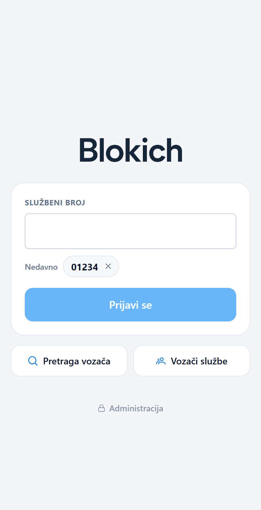
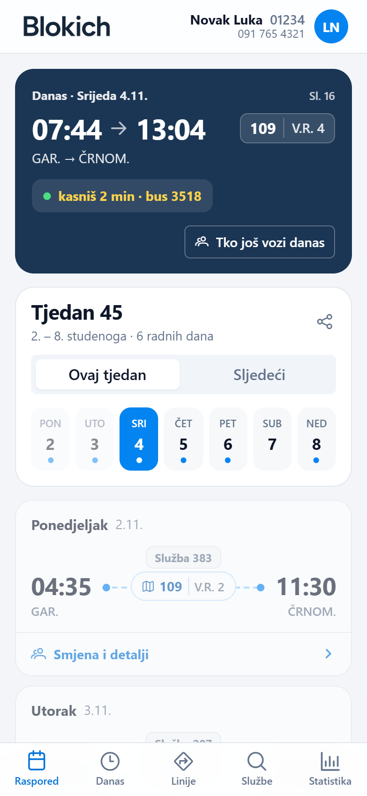
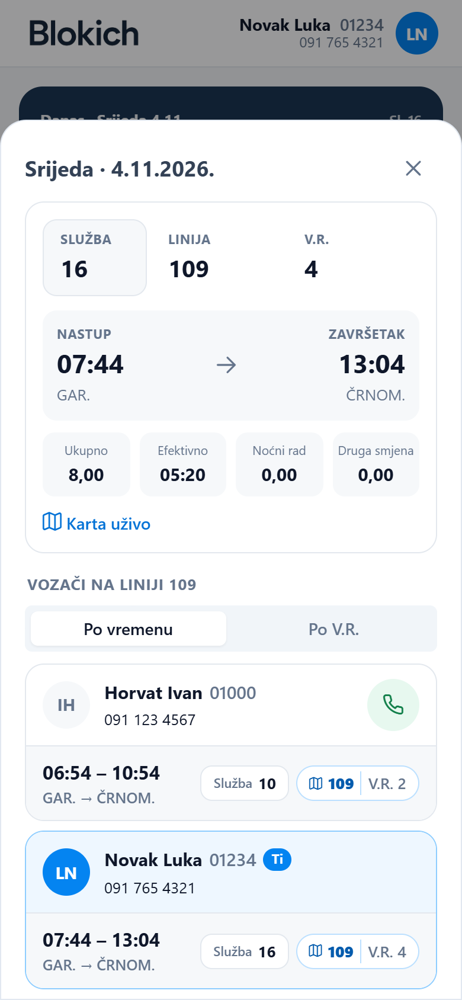
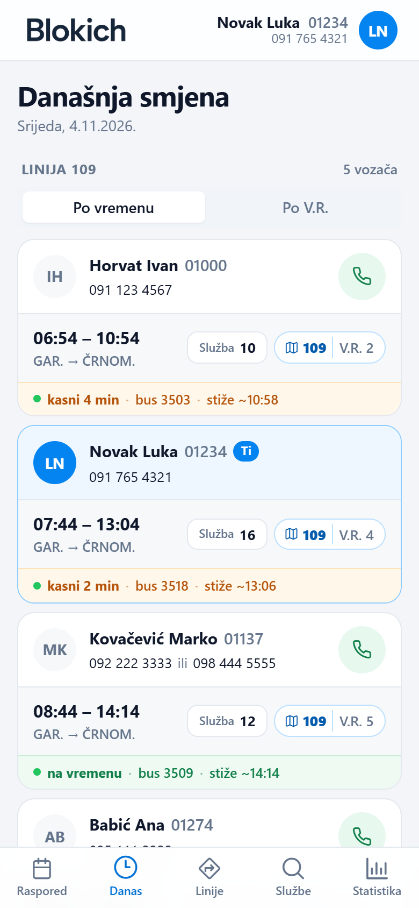
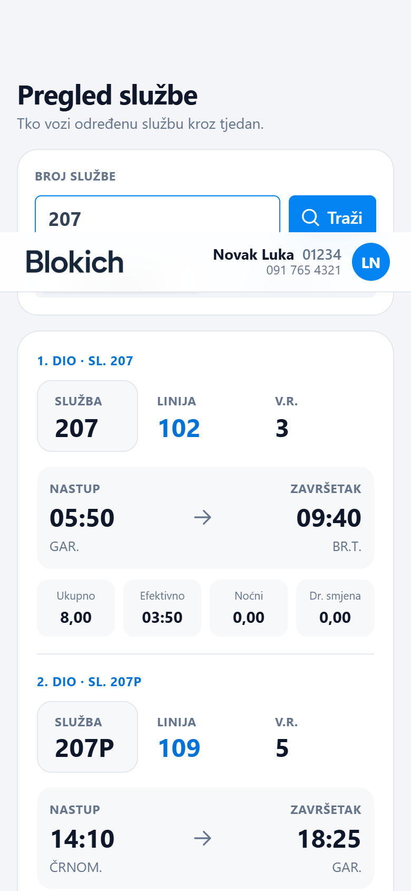

<p align="center">
  
</p>

<p align="center">
  Raspored, smjene i kolege na jednom mjestu – web aplikacija za vozače autobusa ZET-a (AP Podsused).
</p>

<p align="center">
  <a href="https://github.com/to0ony/blokich/actions/workflows/deploy-nestjs.yml"></a>
  <a href="https://github.com/to0ony/blokich/actions/workflows/deploy-fastapi.yml"></a>
  
  
  
  
  
</p>

## Značajke

**Za vozače**
- 📅 Tjedni raspored (aktualni i sljedeći tjedan) s karticom **Danas** na vrhu
- 🟢 **Uživo** iz ZET-ovog GTFS-RT feeda – tko od kolega sad vozi, kašnjenje, broj busa i procjena dolaska na predaju; „tvoj bus stiže ~13:05“ sat prije nastupa
- 👥 Današnja smjena i vozači po liniji – s pozivom jednim dodirom i grupiranjem po V.R.
- 🔎 Pregled službe, uključujući dvokratne službe na više linija
- 📊 Statistika rada po tjednu i mjesecu
- 📱 Mobile-first dizajn

**Za administratora**
- ☁️ Jedan klik povlači službe i disponent s ZET intraneta i obrađuje ih
- 📄 Ručni uvoz PDF-ova (drag & drop), duplikati se prepoznaju po hashu

## Screenshots

| Prijava | Raspored | Smjena | Uživo | Služba |
|:---:|:---:|:---:|:---:|:---:|
|  |  |  |  |  |

<sub>Prikazani podaci i imena su izmišljeni.</sub>

## Arhitektura

```
client/blokich          Angular 19 + PrimeNG          → Vercel
service/blokich         NestJS API + MongoDB          → Hetzner (pm2)
service/blokich/python  FastAPI – parsiranje PDF-ova  → Hetzner (pm2)
```

Vanjski izvori: ZET intranet (PDF službi i disponenta) i ZET GTFS-Realtime feed (vozila uživo).
Spajanje s feedom: blok = linija + V.R. s dvije znamenke (`109` + `2` → `10902`).

## Pokretanje

```bash
# API
cd service/blokich && npm ci && npm run start:dev

# PDF parser
cd service/blokich/python && pip install -r requirements.txt && uvicorn main:app --port 8000

# Frontend
cd client/blokich && npm ci && npm start
```

### Env varijable (`service/blokich/.env`)

| Varijabla | Opis |
|---|---|
| `MONGO_URI` | MongoDB konekcija |
| `JWT_SECRET`, `JWT_EXPIRATION_TIME` | Admin prijava |
| `VOZAC_LOZINKA` | Zajednička lozinka za vozače (bez nje je aplikacija otvorena) |
| `ZET_INTERNO_PASSWORD` | Lozinka ZET intraneta za automatski dohvat PDF-ova |
| `PYTHON_API_BASE_URL` | Adresa PDF parsera (zadano `http://127.0.0.1:8000`) |
| `ZET_GTFS_RT_URL` | GTFS-RT feed (zadano `https://www.zet.hr/gtfs-rt-protobuf`) |

## Deploy

Push na `main` pokreće GitHub Actions koji na serveru napravi `git reset` na `origin/main`, `npm ci`, build i `pm2 restart`. Frontend deploya Vercel, a preview svakog brancha ima pristup API-ju.

---

Licencirano pod [MIT licencom](LICENSE).
