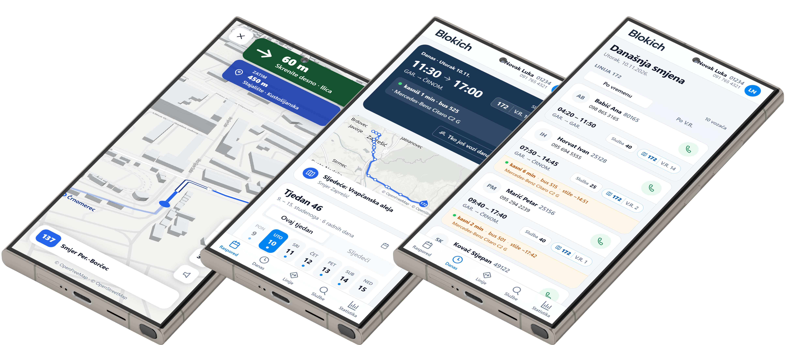
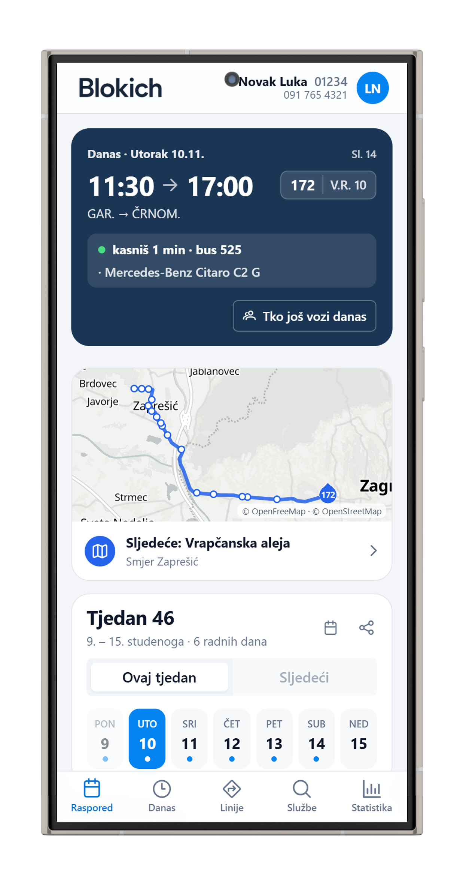
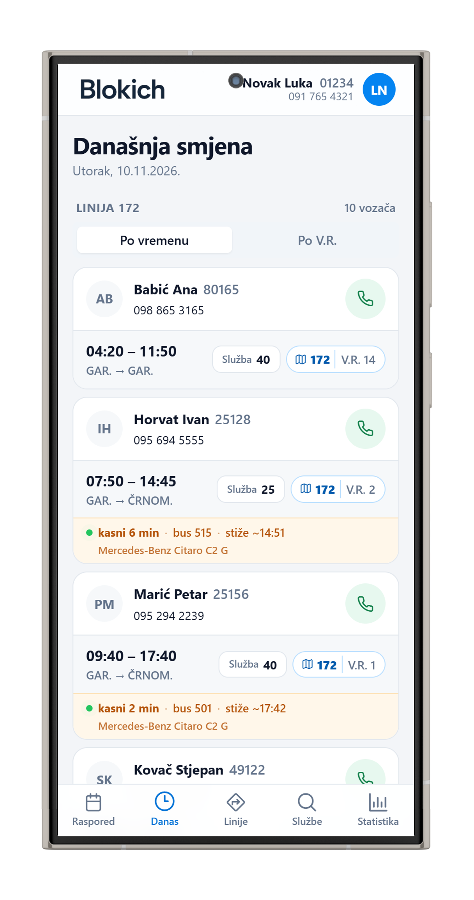
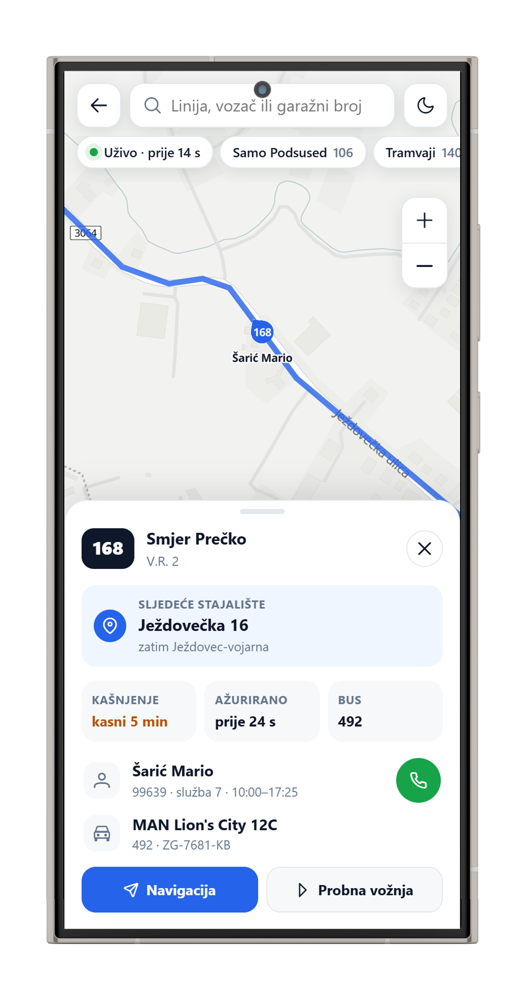
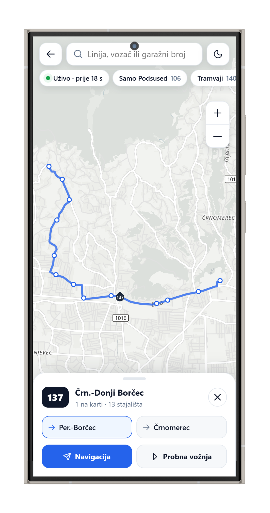
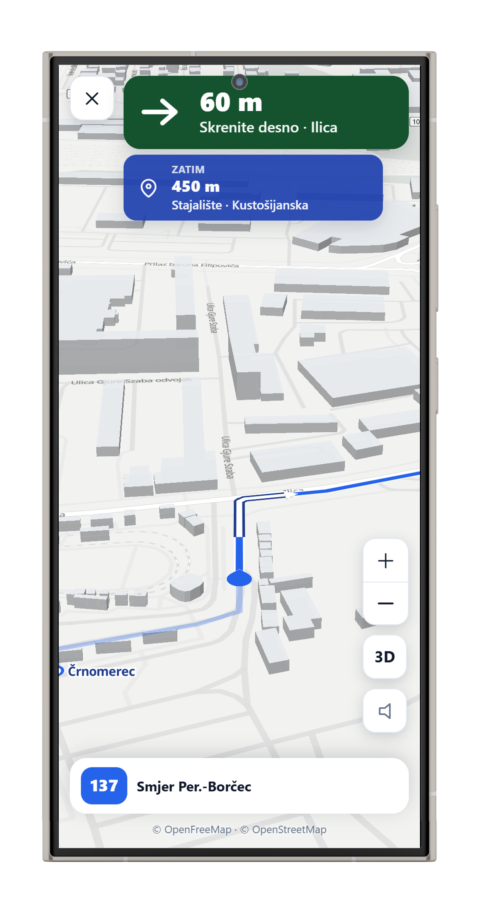
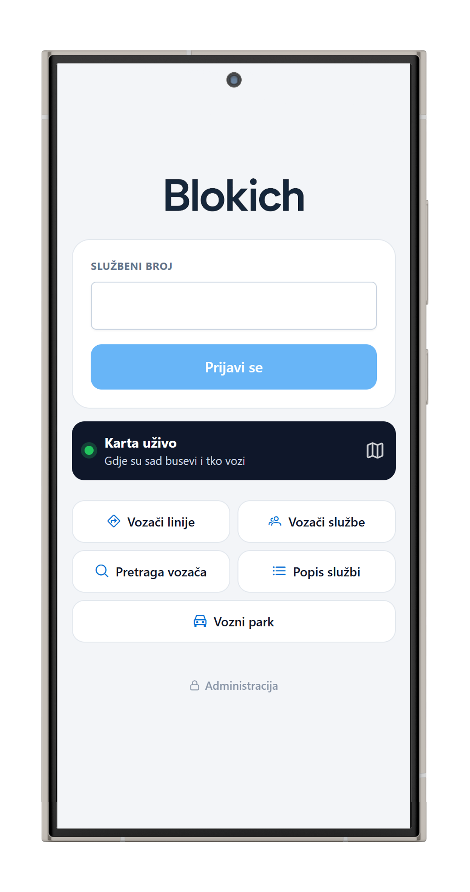

<p align="center">
  <picture>
    <source media="(prefers-color-scheme: dark)" srcset="client/blokich/src/assets/blokich_logo_white.png" />
    <source media="(prefers-color-scheme: light)" srcset="client/blokich/src/assets/blokich_logo.png" />
    
  </picture>
</p>

<p align="center">
  Raspored, smjene, kolege i karta uživo na jednom mjestu – web aplikacija za vozače autobusa ZET-a (AP Podsused).
</p>

<p align="center">
  <a href="https://github.com/to0ony/blokich/actions/workflows/deploy-nestjs.yml"></a>
  <a href="https://github.com/to0ony/blokich/actions/workflows/deploy-fastapi.yml"></a>
  
  
  
  
  
  
</p>

<p align="center">
  
</p>

## Značajke

**Raspored i smjena**
- Tjedni raspored (aktualni i sljedeći tjedan) s karticom **Danas** na vrhu
- **Uživo** iz ZET-ovog GTFS-RT feeda – tko od kolega sad vozi, kašnjenje, broj busa i procjena dolaska na predaju; „tvoj bus stiže ~13:05“ sat prije nastupa
- Ispod kartice Danas karta tvoje linije s busom uživo i sljedećim stajalištem; kad su u danu dvije linije, kartice se listaju
- Današnja smjena i vozači po liniji – s pozivom jednim dodirom i grupiranjem po V.R.
- Pregled službe, uključujući dvokratne službe na više linija
- Statistika rada po tjednu i mjesecu

**Karta uživo**
- Sva vozila ZET-a na karti, s glatkim kretanjem po trasi linije; busevi AP Podsused istaknuti
- Dodir na bus: smjer, sljedeće stajalište, kašnjenje, vozač s pozivom, model i tablica busa
- Pretraga po liniji, vozaču ili garažnom broju; ruta linije s oba smjera i stajalištima
- Filteri (samo Podsused, tramvaji), tamna karta, zoom

**Navigacija (beta)**
- Navigacija po trasi linije prema GPS-u telefona – 2D ili 3D, karta okrenuta u smjeru vožnje
- Sljedeće skretanje i stajalište u karticama gore, strelice skretanja na karti, glasovne najave (po defaultu isključene)
- Snalazi se kad se krene usred linije, vozi u suprotnom smjeru ili okreće na okretištu
- **Probna vožnja** – cijela trasa ubrzano, za učenje nove linije

**Za administratora**
- Jedan klik povlači službe i disponent s ZET intraneta i obrađuje ih
- Ručni uvoz PDF-ova (drag & drop), duplikati se prepoznaju po hashu

Sve je mobile-first.

## Screenshots

| Raspored | Današnja smjena | Karta uživo |
|:---:|:---:|:---:|
|  |  |  |

| Ruta linije | Navigacija | Prijava |
|:---:|:---:|:---:|
|  |  |  |

<sub>Prikazana imena, brojevi i raspored su izmišljeni; vozila, trase i kašnjenja su stvarni ZET podaci.</sub>

## Arhitektura

```
client/blokich          Angular 19 + PrimeNG + MapLibre  → Vercel
service/blokich         NestJS API + MongoDB             → Hetzner (pm2)
service/blokich/python  FastAPI – parsiranje PDF-ova     → Hetzner (pm2)
service/blokich/osrm    OSRM (opcionalno) – skretanja s imenima ulica
```

Vanjski izvori:
- intranet** – PDF službi i disponenta
- GTFS-Realtime** – vozila uživo i kašnjenja (backend ga čita najviše jednom u 5 s)
- GTFS (vozni red)** – linije, trase i stajališta; backend ga sam osvježava svakih 6 h
- / OpenStreetMap** – podloga karte

Spajanje s feedom: blok = linija + V.R. s dvije znamenke (`109` + `2` → `10902`). Vozač na busu dolazi iz disponenta i službi za taj blok.

## Pokretanje

```bash
# API
cd service/blokich && npm ci && npm run start:dev

# PDF parser
cd service/blokich/python && pip install -r requirements.txt && uvicorn main:app --port 8000

# Frontend
cd client/blokich && npm ci && npm start
```

### Env varijable (`service/blokich/.env`)

| Varijabla | Opis |
|---|---|
| `MONGO_URI` | MongoDB konekcija |
| `JWT_SECRET`, `JWT_EXPIRATION_TIME` | Admin prijava |
| `VOZAC_LOZINKA` | Zajednička lozinka za vozače (bez nje je aplikacija otvorena) |
| `ZET_INTERNO_PASSWORD` | Lozinka ZET intraneta za automatski dohvat PDF-ova |
| `PYTHON_API_BASE_URL` | Adresa PDF parsera (zadano `http://127.0.0.1:8000`) |
| `ZET_GTFS_RT_URL` | GTFS-RT feed (zadano `https://www.zet.hr/gtfs-rt-protobuf`) |
| `ZET_GTFS_URL` | Vozni red za trase i stajališta (zadano `https://www.zet.hr/gtfs-scheduled/latest`) |
| `OSRM_URL`, `OSRM_MAX_TOCAKA` | Opcionalno: vlastiti OSRM za skretanja s imenima ulica, vidi [`service/blokich/osrm`](service/blokich/osrm/README.md). Bez njega se skretanja računaju iz oblika trase. |

## Deploy

Push na `main` pokreće GitHub Actions koji na serveru napravi `git reset` na `origin/main`, `npm ci`, build i `pm2 restart`. Frontend deploya Vercel, a preview svakog brancha ima pristup API-ju.

---

Licencirano pod [MIT licencom](LICENSE).
